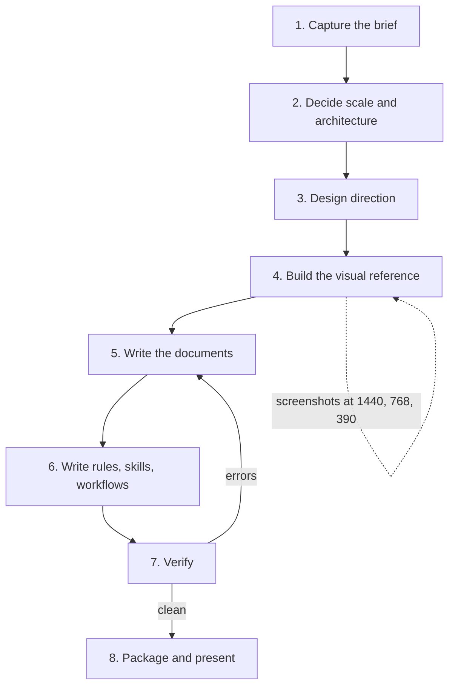

# Antigravity Kit Builder

A skill that turns a **project brief** (a course task, a client request, a side project) into a complete, verified **kit for an AI coding IDE**: a master prompt, a professional README, a design system with a real 60/30/10 color system, a system architecture with decision records, a security model, always-on rules, task-specific skills, workflows, and a screenshot-verified visual reference.

You give the IDE agent the kit. It builds the project from it, with clean architecture, secure code, tests, and an interface that does not look AI-generated.

> Built from three real kits: a student register (easy), an expense tracker (medium) and a learning management system (advanced). Every rule in this skill exists because something went wrong without it. See [Lessons learned](#lessons-learned).

## Contents

1. [Why this exists](#why-this-exists)
2. [What it produces](#what-it-produces)
3. [Installation](#installation)
4. [Quick start](#quick-start)
5. [How it works](#how-it-works)
6. [Levels: easy, medium, advanced](#levels-easy-medium-advanced)
7. [The design method](#the-design-method)
8. [The architecture and security method](#the-architecture-and-security-method)
9. [Scripts reference](#scripts-reference)
10. [Templates reference](#templates-reference)
11. [Worked examples](#worked-examples)
12. [Customizing the skill](#customizing-the-skill)
13. [Lessons learned](#lessons-learned)
14. [Troubleshooting](#troubleshooting)
15. [Limitations](#limitations)
16. [Repository layout](#repository-layout)

## Why this exists

Pasting "build me an expense tracker" into an AI IDE produces working code with a generic look: purple gradients, four KPI tiles with icons, donut charts, floats for money, one giant `server.js`. The agent is capable. It lacks **constraints, taste and a definition of done**.

This skill supplies all three, in a form the IDE loads automatically:

| Problem with a bare prompt | What the kit does about it |
|---|---|
| Generic AI visual style | A design system with a domain-derived palette (60/30/10), a designed type pair, one signature element and an explicit ban list |
| Beginner code structure | Rules for layers, strict typing, file and function size, contracts shared between client and server |
| Silent correctness bugs (money, time, grades, quiz timing) | A domain skill with numbered rules and hand-computed test requirements |
| Security as an afterthought | A threat model, controls, and a numbered list of security tests the agent must implement |
| "Looks done" without proof | Verification gates: lint, types, tests, security review, design review, performance budgets |
| Unreviewable claims | Contrast ratios are measured, diagrams are parsed, links are checked, layouts are screenshotted |

## What it produces

```
<product>-kit/
├── PROMPT.md                      master prompt to paste into the agent
├── README.md                      the project's own README (matches the target structure)
├── docs/
│   ├── DESIGN_SYSTEM.md           60/30/10 palette, type scale, components, motion, bans
│   ├── design-reference.html      the main screen with real numbers, rendered and verified
│   ├── ARCHITECTURE.md            style, diagrams, data model, API catalog, ADRs   (medium and up)
│   └── SECURITY.md                threat model, controls, required tests            (medium and up)
└── .agents/
    ├── rules/                     always-on: project-standards, security-rules, design-guardrails
    ├── skills/<name>/SKILL.md     6 to 10 task-specific playbooks, one is a domain skill
    └── workflows/                 /verify, /review-design, /security-review, /perf-audit
```

## Installation

The skill is a folder with a `SKILL.md` (YAML frontmatter `name` and `description`) plus supporting files, the format used by Antigravity workspace skills and by Claude skills.

**Antigravity (workspace):**

```bash
mkdir -p .agents/skills
cp -r antigravity-kit-builder .agents/skills/
```

Older Antigravity versions read `.agent/skills/` instead of `.agents/skills/`. Check the current Antigravity documentation for the exact folder names and for how to install a skill globally, since the product evolves.

**Other tools:** place the folder wherever the tool loads skills from, or open `SKILL.md` and follow it by hand. The procedure does not depend on a specific IDE.

**Script requirements** (only for verification and screenshots):

| Need | For |
|---|---|
| Python 3.9+ | all scripts |
| `pip install playwright` and `playwright install chromium` | `shoot.py`, `validate_kit.py --mermaid` |
| Node.js and `npm` with network access | `validate_kit.py --mermaid` (installs `mermaid@10` into a temp folder once) |

Without Playwright the scripts degrade gracefully: Mermaid parsing is skipped with a warning and `shoot.py` exits with an explanation.

## Quick start

Once installed, describe the project. The skill triggers on the description, you do not need to name it.

Examples that trigger it:

```
Here is my task: [paste the task]. Give me a prompt for Antigravity with a pro design
system and a README, not beginner style.
```

```
Same work as last time, now for this project: [paste the brief].
Use 60/30/10 colors and harmonious typography.
```

```
Make me the kit for a booking app for a barbershop.
```

What happens next, in short: the agent reads your brief, chooses the scale, designs the look, builds and screenshots a visual reference, writes the documents, writes rules and skills, runs the verification scripts, fixes what they report, and hands you a zip plus a summary of what was and was not verified.

Using the kit afterwards (any project):

1. Create an empty folder and copy `.agents/`, `docs/` and `README.md` from the kit into it.
2. Open the folder in the IDE and choose **Planning** mode.
3. Paste everything under the line in `PROMPT.md` into the agent chat.
4. Let it plan, build phase by phase, and run `/verify` at the end.

## How it works



| Step | What the agent does | Output |
|---|---|---|
| 1. Capture the brief | Extracts title, level, features, the five workflow steps. Asks at most one question, otherwise states assumptions | Shared understanding |
| 2. Decide scale | Matches level to architecture style and stack, lists domain correctness traps | Style and ADR candidates |
| 3. Design direction | Explores the product's world, picks a 60/30/10 palette, a type pair, a signature, rejects three defaults, measures contrast | Tokens and rationale |
| 4. Visual reference | Builds the main screen with numbers that add up, screenshots it at three widths, fixes defects | `design-reference.html` |
| 5. Documents | Scaffolds from templates, fills design, architecture, security, README, prompt in that order | `docs/*`, `README.md`, `PROMPT.md` |
| 6. Rules, skills, workflows | Writes short checkable rules, 6 to 10 skills with pushy descriptions, 4 workflows | `.agents/*` |
| 7. Verify | Runs validation, contrast and screenshot scripts and fixes everything reported | Clean report |
| 8. Package | Zips, presents, summarizes in the user's language with honest caveats | Deliverable |

The kit files are written in English because IDE agents follow English instructions most reliably. The conversation with you stays in your language.

## Levels: easy, medium, advanced

| | Easy | Medium | Advanced |
|---|---|---|---|
| Typical brief | CRUD with a database | Auth, reports, charts | Roles, assessments, deployment, performance |
| Architecture | Simple layered app | Layered monolith with shared `contracts` package | Modular monolith, policies, domain events |
| Auth | None or basic | DB-backed cookie sessions plus CSRF | Short JWT in memory plus rotating refresh cookie, RBAC |
| Documents | README, DESIGN_SYSTEM, PROMPT | plus ARCHITECTURE and SECURITY | same, with 10 ADRs and a scaling path |
| Rules | 2 | 3 | 3 |
| Skills | 3 to 6 | 8 to 9 | 8 to 10 |
| Workflows | verify, review-design | plus security-review, perf-audit | all four |
| Scaffold | `--level easy` | `--level medium` | `--level advanced` |

Not used at any level unless the brief demands it: microservices, Kubernetes, Redis, message queues. They are documented as the **scaling path**, with the pressure that would justify each.

## The design method

The full method is in [`references/design-method.md`](references/design-method.md). Highlights:

**Domain first.** Before any color is chosen the agent writes the product's world: 5 concepts, 5 colors that live there, one signature element, 3 rejected defaults. The product and its tokens are named from that world (Dars, `--chalk-50`, `--pencil-500`).

**60/30/10, measured by screen area.**

| Share | Role | Typical content |
|---|---|---|
| 60% | Dominant neutral | Ground, panels, rows, inputs |
| 30% | Secondary structure | Nav surface, rules, tracks, ink, completed progress |
| 10% | Accent | The one primary action, current position, main data series |
| outside | Status | Success, danger, warning on marks and tags only |

**Contrast is computed, never estimated.** Hard rules that caught real errors: text 4.5:1, **control borders 3:1** (a translucent 12% line measures about 1.5:1 and is for dividers only), tinted fills tested as their own pairs, quiet decorative marks allowed below 3:1 only when text carries the same information.

**Typography.** A superfamily or a pair designed together, a fixed rem scale at ratio 1.2 (12, 14, 16, 19, 23, 28, 33, 40), tabular numerals everywhere, serif only for titles and figures, never in controls.

**One signature element** that answers the product's core question and appears in at least five places (a Lesson Trail for "where am I in this course", a Pace Marker for "am I on track").

**Honest charts.** One hue per chart, no pie, donut or gauge, a finding sentence above, direct labels, a "View as table" alternative, no entrance animation.

**Bans.** Gradients, glass, glow, violet or indigo, progress rings, icon-in-circle KPIs, sparklines on KPIs, eyebrows, ALL-CAPS labels, emoji, "Welcome back" heroes, nested cards, placeholder content.

## The architecture and security method

Detail in [`references/architecture-method.md`](references/architecture-method.md) and [`references/security-method.md`](references/security-method.md).

- **Style by level**, boring by default, every non-obvious choice recorded as an ADR row (decision, why, alternatives rejected).
- **Domain rules as numbered statements**, then again in a domain skill: money as integer minor units, dates as plain days with user-timezone boundaries, server-authoritative quiz deadlines, one defined progress formula.
- **Layers:** controller (HTTP only), service (rules), repository (the only data access), pure domain and policy functions. Modules talk through services or events.
- **Owner scoping by construction:** every repository function takes the owner id first, foreign keys from the client are verified, other users' resources return 404.
- **Security as a feature:** STRIDE-condensed threat model, controls by default (argon2id, uniform auth responses, CSRF or token rotation, strict Zod schemas, CSP, log redaction, CSV injection guard, account export and deletion), OWASP mapping, and a numbered list of **required security tests**.
- **Diagrams** in Mermaid: context, ERD, auth sequence, state machine, deployment. They are parsed during verification.

## Scripts reference

All scripts are standard Python 3, run from the skill folder (or give the full path).

### `scaffold_kit.py`

Creates the kit structure from the templates so nothing is forgotten.

```bash
python scripts/scaffold_kit.py my-product-kit --level medium --set PRODUCT=Masrouf
```

| Option | Meaning |
|---|---|
| `out` | Output folder |
| `--level easy\|medium\|advanced` | Which files to include (easy omits architecture, security, deploy and performance pieces) |
| `--set KEY=VALUE` | Replace `{{KEY}}` everywhere. Repeatable |

Output: `scaffolded 21 files into ... (level medium)`. Remaining placeholders and `<!-- GUIDE -->` comments are reported later by the validator.

### `validate_kit.py`

```bash
python scripts/validate_kit.py my-product-kit --level medium --mermaid
```

| Check | Detail |
|---|---|
| Required files | Depends on level |
| Skill frontmatter | `name` equals folder name, description long enough to trigger |
| Workflow frontmatter | `description` present |
| Placeholders | `{{...}}` and `<!-- GUIDE` are errors. `TODO`, `TBD`, `lorem ipsum` are warnings, skipping rule text and quoted examples |
| Links and anchors | Every relative link and `#anchor` in every Markdown file |
| Cross references | Skills and workflows named in `PROMPT.md` must exist, API paths are ignored |
| Mermaid (`--mermaid`) | Every diagram is parsed with the real Mermaid parser |

Sample output on a clean kit:

```
mermaid: parsed 4 diagram(s)
9 skills, 4 workflows, 0 error(s), 0 warning(s)
```

Exit code is 1 when any error is found.

### `contrast.py`

```bash
python scripts/contrast.py --pairs \
  "#172016:#FFFFFF:ink on white" \
  "#7E8A79:#FFFFFF:control border on white:3" \
  "#B0BAAB:#FFFFFF:chart compare line:3"
python scripts/contrast.py --blend "#172016" 0.22 "#FFFFFF"
```

```
PASS  16.74  (need 4.5)  ink on white
PASS   3.62  (need 3)  control border on white
FAIL   2.01  (need 3)  chart compare line
effective #CCCECC  contrast vs #FFFFFF: 1.58
```

A pair is `foreground:background:label[:threshold]`, default threshold 4.5. Use 3 for borders and graphics. `--blend` computes the effective color of a translucent value and its contrast.

### `shoot.py`

```bash
python scripts/shoot.py my-product-kit/docs/design-reference.html --out shots
```

Renders at 1440, 768 and 390 pixels and reports, per width: horizontal overflow, and any rendered text under 11px (SVG text is measured after the viewBox scale, which is where charts usually fail).

```
1440px  overflow=no  small-text=none  -> shots/w1440.png
768px   overflow=no  small-text=none  -> shots/w768.png
390px   overflow=no  small-text=none  -> shots/w390.png
```

The numbers do not replace looking at the images. Do both. `--full` takes full-page screenshots.

### `package_kit.py`

```bash
python scripts/package_kit.py my-product-kit
```

Zips the folder without junk (`node_modules`, `__pycache__`, `.git`, `shots`) and writes to `/mnt/user-data/outputs` when it exists, otherwise to the current folder.

## Templates reference

All templates are in `assets/templates/` with a `.tpl` suffix. Conventions:

- `{{UPPER_SNAKE}}` is a value to fill. `scaffold_kit.py --set` can fill some automatically.
- `<!-- GUIDE: ... -->` is an instruction to the author. It must be deleted. The validator fails on any that remain.
- Templates describe structure and rules, not the content of one product.

| Template | Becomes |
|---|---|
| `PROMPT.md.tpl` | Master prompt with role, product, stack, phases mapped to the task's steps, quality bar, do-not list, definition of done |
| `README.md.tpl` | The project's final README |
| `docs/DESIGN_SYSTEM.md.tpl` | Direction, 60/30/10 table, tokens with measured contrast, type scale, components, bans |
| `docs/ARCHITECTURE.md.tpl` | Goals, style, diagrams, data model, domain rules, auth, API catalog, ADRs, structure |
| `docs/SECURITY.md.tpl` | Threat model, controls, OWASP mapping, required tests |
| `design-reference.template.html` | A working scaffold of a main screen, ratio bar, swatches, type scale (replace content, keep structure) |
| `rules/*.md.tpl` | `project-standards`, `security-rules`, `design-guardrails` |
| `skills/*/SKILL.md.tpl` | `system-architect`, `auth-security`, `backend-api`, `frontend-ui`, `testing-qa`, `devops-optimization`, `design-review`, and a `domain-skill` pattern |
| `workflows/*.md.tpl` | `verify`, `review-design`, `security-review`, `perf-audit` |

21 template files in total.

## Worked examples

Three kits were built with this method. Each has a different identity on purpose, because the skill forbids reusing a palette or type pair.

| Kit | Level | Palette (60 / 30 / 10) | Type | Signature | Stack and auth |
|---|---|---|---|---|---|
| **Student register** | Easy | Cool paper `#EFF1F6` / ink navy `#16245C` / highlighter `#FFD23F` | Crimson Pro and Atkinson Hyperlegible | Student ID card | React, Express, Prisma, SQLite, no auth |
| **Masrouf** expense tracker | Medium | Paper `#F7F6F2` / ledger green-black `#172016` / stamp blue `#2A5BD7` | Source Serif 4 and Source Sans 3 | Pace Marker (budget bars and spending against "where you should be today") | React, Express, Prisma, PostgreSQL, cookie sessions plus CSRF |
| **Dars** LMS | Advanced | Chalk `#F4F6F5` / board `#0F2A2E` / pencil `#F2A100` | IBM Plex Serif, Sans, Mono | Lesson Trail (one segment per lesson) | React, NestJS, Prisma, PostgreSQL, JWT in memory plus rotating refresh cookie, RBAC |

The register kit predates the visual reference step and fails the current validator on that one missing file, which is the validator doing its job.

## Customizing the skill

- **New default fonts or palette rules:** edit `references/design-method.md`, and the examples in section 4.
- **A new domain skill** (inventory, booking, scheduling): follow the pattern in `references/skill-outlines.md` and `assets/templates/skills/domain-skill/`. Rules as numbered statements, formulas, hand-computed tests, constraints that forbid the common mistake.
- **A different stack:** change `references/architecture-method.md` section 2 and the stack bullets in `PROMPT.md.tpl` and `README.md.tpl`. Keep the layer rules.
- **A different IDE:** change the folder names in `references/kit-anatomy.md` section 2 and `SKILL.md`. The documents stay the same.
- **Stricter or looser verification:** edit `validate_kit.py` (`BASE_REQUIRED`, `MIN_SKILLS`) and the thresholds you pass to `contrast.py`.

Keep `SKILL.md` short and procedural, and move detail into `references/`, so the agent loads detail only when it needs it.

## Lessons learned

The complete list is in [`references/lessons-learned.md`](references/lessons-learned.md). The ones that shaped the tooling:

1. **Estimated contrast was wrong three times.** A border claimed at 3:1 measured 1.56:1, a success color on its own tint measured 4.35:1, a chart line measured 2:1. Hence `contrast.py`.
2. **A layout "fixed by eye" was still broken.** After a mobile fix the reference page still overflowed at 768px and its chart text rendered at 9px. Hence `shoot.py`, which measures rendered text size and overflow at three widths.
3. **Diagrams and links break silently.** Hence `validate_kit.py --mermaid`.
4. **Generated design suggestions default to the generic look.** A design-system search suggested glassmorphism, neon green and a children's font for an adult LMS. Treat tools as references, reject what does not fit the domain.
5. **Scaffolding found its own bug.** The first medium scaffold omitted a workflow the prompt referenced, caught by the validator's cross-reference check.
6. **Environment traps:** `sh` does not expand `{a,b}` braces, background servers can die between commands, a script that applies edits and writes at the end loses all edits if one assertion fails.

## Troubleshooting

| Symptom | Cause and fix |
|---|---|
| The skill does not trigger | The description is the trigger. Mention a project brief, a prompt for the IDE, a design system or a README. Check the folder is in `.agents/skills/` (or `.agent/skills/` on older versions) |
| `validate_kit.py` reports many placeholders after scaffolding | Expected. Fill each `{{...}}` and delete each `<!-- GUIDE -->`. The count should reach zero |
| `skill folder name does not match` error | The `name` in a skill's frontmatter must equal its folder name. The `domain-skill` template has a placeholder name to replace |
| `playwright is not installed` | `pip install playwright` then `playwright install chromium` |
| Mermaid check says "could not install mermaid" | `npm` needs network access. Run it once with network, the package is cached in the temp folder |
| Fonts look different in screenshots | The sandbox cannot reach Google Fonts, so fallbacks render. Open the HTML in a normal browser to see the real fonts |
| `PROMPT.md references skill ... that does not exist` | A phase mentions a skill the level omits. Edit the prompt or add the skill |
| Overflow reported only at 768px | The nav or toolbar breakpoint is too low. Wrap or collapse it at about 900px |

## Limitations

- The kits were **not executed inside Antigravity** during creation. Everything verifiable without the IDE was verified (contrast, links, diagrams, frontmatter, rendering). Whether an agent builds the whole project from a kit depends on the model and the IDE version.
- Folder names and skill-loading behavior of the IDE may change. Confirm against its current documentation.
- Fonts load from Google Fonts. Offline environments fall back to system fonts.
- The visual reference is a static page, not the finished application. It fixes the look, not the behavior.
- Right-to-left (Arabic) is prepared through logical CSS properties and `Intl`, not implemented.
- No license is included. Add one before redistributing.

## Repository layout

```
antigravity-kit-builder/
├── SKILL.md                       the procedure the agent follows
├── README.md                      this file
├── references/
│   ├── design-method.md           domain exploration, 60/30/10, type, motion, charts, bans
│   ├── architecture-method.md     level matrix, layers, auth options, domain rules, ADRs
│   ├── security-method.md         threat model structure, default controls, required tests
│   ├── kit-anatomy.md             file inventory, IDE format, step-to-phase mapping
│   ├── skill-outlines.md          which skills to write and what each contains
│   └── lessons-learned.md         defects found and how they were prevented
├── scripts/
│   ├── scaffold_kit.py            create the kit structure from templates
│   ├── validate_kit.py            structure, frontmatter, placeholders, links, Mermaid
│   ├── contrast.py                WCAG contrast and translucent blends
│   ├── shoot.py                   screenshots and layout defects at three widths
│   └── package_kit.py             zip and deliver
└── assets/templates/              21 templates (documents, rules, skills, workflows, HTML scaffold)
```
